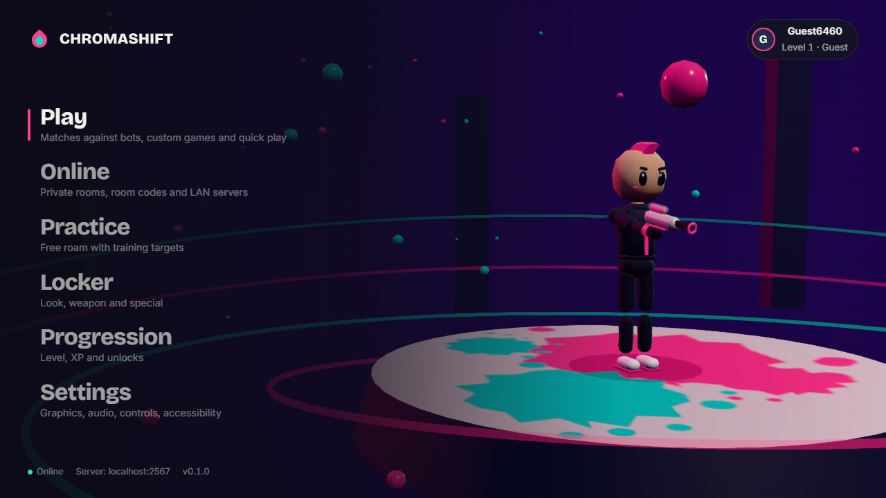
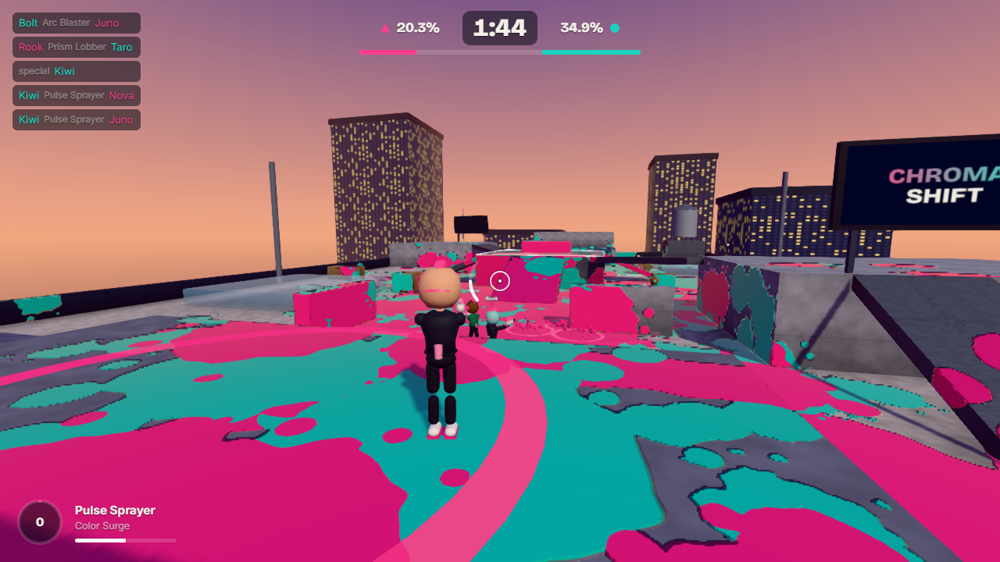

# CHROMASHIFT

A colourful third-person team paint shooter that runs in the browser. Two teams of four race to cover the arena in their colour: shoot, roll and lob paint, dive into your own colour to swim and refill, climb painted walls, and splat rivals. It plays fully offline against bots, online with friends in private rooms, and on your LAN from a self-hosted server.

**Play:** https://plodroid.github.io/game/ (installable as an app)




## Features

- **Turf Control** (main mode), **Zone Control**, **Knockout** and a **Practice** range. 3-minute matches by default, adjustable from 1 to 5 minutes.
- **Five weapons**, each with its own behaviour: Pulse Sprayer (automatic), Stripe Roller (roll and flick), Arc Blaster (detonating bursts), Prism Lobber (three-way arcing shells), Dual Stream (twin rapid fire with a fast dodge).
- **Five specials**: Color Surge, Paint Nova, Shield Burst, Bounce Beacon, Disruption Pulse. You charge them by painting new territory and by KOs.
- **Movement**: walk, sprint, slide, dodge roll, double jump, air control, coyote time and jump buffering. **Paint dive**: swim fast through your own colour, refill pigment, climb walls painted your colour. Rival paint slows and chips at you, but you can always walk out.
- **GPU paint system**: every paint event becomes instanced splat stamps rendered into an atlas render target (one draw call per frame). Map materials read the atlas for colour, gloss and raised paint edges. Territory scoring uses an ownership grid over the real paintable area, excluding occluded and overlapping surfaces.
- **Bots that actually play**: an auto-generated navigation graph (walk, jump, drop and launch-pad links), A* routing that avoids rival paint, painting goals, fighting with leading aim and ledge awareness, refilling, retreating, supporting teammates, team goal claims and specials. Four difficulties change reaction time, aim wobble, turn rate and strategy; bots never get extra rules or perfect aim.
- **Three original maps**: Skyline (sunset rooftops), Core (indoor arena with glass roof), Float (islands in the clouds). Maps are mirrored, so both teams get identical routes.
- **Multiplayer**: Colyseus server running the same simulation authoritatively. Room codes, Quick Play, host controls, bot fill, late join, reconnection, client prediction with reconciliation, snapshot interpolation, input validation and rate limiting.
- **Accounts** (optional, free Firebase Spark plan): Continue with Google or email and password, unique case-insensitive usernames, profiles, cloud-synced settings and progression, guest play with later linking.
- **Settings**: Very Low to Ultra graphics presets plus every option individually, hardware check, audio buses, key rebinding, gamepad and touch controls, camera and HUD options, and accessibility (colour-blind palettes with shape markers, text size, reduced motion, subtitles, visual audio cues, high contrast).
- **PWA**: installable, works offline against bots, asks before updating.
- **All assets are original and generated in code**: character and weapon models, textures, music and sound effects. Nothing is downloaded or licensed.

## Technology

| Area | Choice |
| --- | --- |
| Rendering / engine | three.js r187 (used directly; React never drives the render loop) |
| Physics | Rapier 3D 0.21 (kinematic character controller, capsule collision, fixed 60 Hz step) |
| UI | React 19 + Zustand, hand-written CSS |
| Build | Vite 8, vite-plugin-pwa (Workbox) |
| Multiplayer | Node.js 22 + Colyseus 0.18 over WebSockets |
| Accounts | Firebase Authentication + Cloud Firestore (Spark plan), Firebase Admin on the server (optional) |
| Local storage | IndexedDB (profile) and localStorage (settings) |
| Quality | TypeScript strict, ESLint, Prettier, Vitest, Playwright |

No C++/WebAssembly of our own: the simulation costs about 0.2 ms per tick for 8 bots, so profiling gave no reason to add it. Rapier itself ships as WebAssembly.

## Quick start

Requires Node.js 20.19+ (22 recommended).

```bash
npm install
```

```bash
npm run dev            # web client at http://localhost:5173/game/
```

```bash
npm run dev:server     # multiplayer server at ws://localhost:2567
```

The dev client connects to `ws://localhost:2567` automatically. Offline play needs no server.

| Command | What it does |
| --- | --- |
| `npm run build` | Production client in `apps/client/dist` (base path `/game/`) |
| `npm run preview` | Serve the production build at http://localhost:4173/game/ |
| `npm run start:server` | Run the multiplayer server (also serves the built client at `/game/`) |
| `npm test` | Unit tests, full headless bot matches on every map, multiplayer integration tests |
| `npm run test:e2e` | Playwright smoke tests against the production build (run `npm run build` first) |
| `npm run typecheck` | TypeScript for all three workspaces |
| `npm run lint` / `npm run format` | ESLint / Prettier |
| `npm run icons` | Regenerate PWA icons (needs ImageMagick) |

## Project structure

```
apps/client/        Web client (Vite + React + three.js)
  src/game/         engine loop, match/menu views, input, camera, session flow
  src/rendering/    paint atlas, map meshes, environment, effects, post-processing
  src/characters/   procedural character model + animation controller
  src/weapons/      procedural weapon models
  src/audio/        synthesized sound effects, music, ambience
  src/multiplayer/  Colyseus client, prediction / interpolation source
  src/auth/         Firebase accounts and cloud sync (lazy-loaded)
  src/settings/     settings store, presets, hardware detection
  src/ui/           screens, HUD and UI kit
apps/server/        Colyseus server (rooms, authentication, static hosting)
packages/shared/    Simulation shared by both: maps, physics, paint grid,
                    movement, combat, bots, modes, protocol, validation
docs/               Architecture, multiplayer hosting, Firebase setup
e2e/                Playwright tests
```

The key design decision: **one simulation, two hosts.** `packages/shared` runs the whole game (players, weapons, paint, bots, scoring). Offline, the browser runs it locally. Online, the server runs it authoritatively and clients send inputs only. See [docs/ARCHITECTURE.md](docs/ARCHITECTURE.md).

## Controls

| Action | Keyboard / mouse | Gamepad |
| --- | --- | --- |
| Move | W A S D | Left stick |
| Look / aim | Mouse | Right stick |
| Fire (hold to roll with the roller) | Left click | RT |
| Paint dive: swim, refill, climb (hold) | Right click or F | LT |
| Jump / double jump | Space | A |
| Sprint | Left Shift | L3 |
| Slide (while sprinting) | C | B |
| Dodge | Q | X |
| Special | E | RB |
| Emote | T | Y |
| Scoreboard (hold) | Tab | View |
| Pause | Esc | Menu |

Every keyboard and mouse binding can be changed in Settings → Controls. Touch screens get an on-screen stick and buttons. Menus work with the D-pad (A selects, B goes back).

## Multiplayer

The website (GitHub Pages) is **static**: it can't run the game server. Multiplayer needs a CHROMASHIFT server running somewhere.

- **LAN (easiest):** on one computer run `npm install`, `npm run build`, `npm run start:server`. The console prints addresses such as `http://192.168.1.20:2567/game/`. Everyone on the network opens that address and the game connects to that server automatically. You may need to allow Node.js through the firewall.
- **Direct connect:** Online → Direct connect → host/IP and port.
- **Internet:** see [docs/MULTIPLAYER.md](docs/MULTIPLAYER.md) for port forwarding, NAT and firewall setup, TLS (`wss://`) via a free reverse proxy or tunnel, and the limits of hosting from home.

Browsers block plain `ws://` connections from an HTTPS page, except to `localhost`. So the public site at `https://plodroid.github.io/game/` can only join `wss://` servers. For a LAN server without TLS, open the game from the server's own address, as described above.

## Accounts

Accounts are optional; everything works as a guest. To enable Google and email sign-in, create a free Firebase project (Spark plan, no billing) and set the `VITE_FIREBASE_*` values. Full steps, including authorised domains and the security rules in [firestore.rules](firestore.rules), are in [docs/FIREBASE.md](docs/FIREBASE.md).

What's stored: passwords are handled only by Firebase Authentication. Firestore holds a private profile (owner-only), a public card (username, display name, level, look), the username registry, and verified online stats written only by trusted servers. Offline results are client-reported and labelled as such; online results are verified only when the server has Firebase Admin credentials.

## GitHub Pages deployment

[.github/workflows/deploy.yml](.github/workflows/deploy.yml) runs on every push to `main`. It installs dependencies, typechecks, lints, runs the unit, simulation and multiplayer tests, builds the client, runs the end-to-end tests, then uploads `apps/client/dist` and deploys it with the Pages Actions flow. The repository's Pages source must be **GitHub Actions** (Settings → Pages).

Optional repository **Variables** (Settings → Secrets and variables → Actions → Variables): `VITE_FIREBASE_API_KEY`, `VITE_FIREBASE_AUTH_DOMAIN`, `VITE_FIREBASE_PROJECT_ID`, `VITE_FIREBASE_APP_ID`, `VITE_FIREBASE_MESSAGING_SENDER_ID`, `VITE_DEFAULT_SERVER_URL`. All are public values (the API key may be stored as a Secret instead; the workflow accepts either). Never put a service account in the client build.

## Installing the app (PWA)

- **Desktop Chrome / Edge:** the install icon in the address bar, or menu → Install CHROMASHIFT.
- **Android:** menu → Add to Home screen / Install app.
- **iOS / iPadOS Safari:** Share → Add to Home Screen.

The installed app opens straight into the game and keeps working offline for bot matches. When a new version is deployed, it asks before updating. Online play checks the protocol version, so an outdated cached copy can't join an incompatible server.

## Graphics and performance

WebGL2 is required. If it's unavailable, the game shows a message explaining how to fix it.

| Preset | What changes |
| --- | --- |
| Very Low | 60% resolution capped at 720p, no shadows (blob shadows instead), no AO, bloom, reflections or post, low paint atlas, Lambert materials, fewer particles, short draw distance |
| Low | Low-resolution shadows refreshed every 3rd frame, no post |
| Medium | Default: shadows, reflections, FXAA, raised paint edges |
| High | Sharper shadows and textures, bloom |
| Ultra | 4096 soft shadows, MSAA, GTAO ambient occlusion, supersampling |

Measured on an **NVIDIA GeForce GT 740** (the low end this project targets), full frame (simulation plus render) at a forced 1080p: Very Low 8.8 ms, Low 10.6 ms, Medium 13.2 ms, High 12.4 ms, Ultra 41 ms. At 720p: Very Low 4.4 ms, Medium 6.5 ms. These are single-scene measurements, not promises: real frame rates depend on the scene, browser, drivers, CPU and resolution. Settings → Graphics → Hardware check runs a short benchmark and recommends a preset. It never changes anything by itself. During matches, the game may *suggest* a lower preset if frames drop; you decide.

## Troubleshooting

- **Black screen or the "can't run" message:** enable hardware acceleration in the browser, update graphics drivers, try Chrome, Edge or Firefox.
- **Low FPS:** pick Very Low, or lower Resolution scale. Close other GPU-heavy tabs.
- **Can't connect to a server:** check the address and port, that the server is running, and the firewall. From the HTTPS site, the server must use `wss://`. The Online screen shows the server's status.
- **"Different version" when joining:** refresh the page or accept the update prompt, or ask the host to update.
- **Sign-in popup blocked:** allow popups, or the game falls back to a redirect. "Unauthorized domain" means the site's domain must be added in Firebase Authentication → Settings → Authorized domains.
- **Progress not syncing:** it stays saved on your device and syncs when the account service is reachable. The Profile screen shows the sync status.

## Credits and licensing

Everything in CHROMASHIFT was made for this project: code, characters, maps, textures, music and sound, generated procedurally. Fonts: Inter and Bricolage Grotesque (SIL Open Font License) via Fontsource. Third-party libraries keep their own licences (three.js MIT, Rapier Apache-2.0, React MIT, Colyseus MIT, Firebase Apache-2.0).
